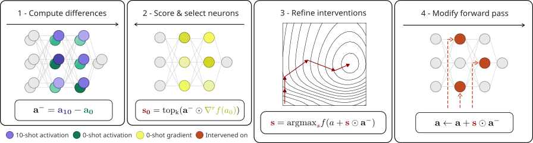

# Distributed Sparse Interventions in Language Models

  

This repository contains code for the preprint [Distributed Sparse Interventions in Language Models](https://arxiv.org/abs/2607.07128).

## Setting up the environment
You can use the "DSI.def" file to build a singularity container that has all necessary packages installed. It builds on top of a container provided by AMD that already has pytorch installed (from https://hub.docker.com/r/rocm/pytorch), if you use an NVIDIA graphs card, you have to switch the base container respectively (https://catalog.ngc.nvidia.com/orgs/nvidia/containers/pytorch).

Depending on the models, you will need to request access to the respective huggingface implementation (necessary for llama and gemma, but not for Qwen).
transformer_lens can then use your huggingface token to access these models, if you provide it as an environment variable (in the example slurm script below, via export HF_TOKEN=...).

## Preparing the task datasets
Run `prepare_data/split.py`.
This will download the json datasets from [the function vectors repository](https://github.com/ericwtodd/function_vectors) and create a `data` folder containing train/test splits.
This step only takes a few seconds and does not need special compute resources.

## Running the experiments
To reproduce the main experiments, run `main_results/experiments.py` with default arguments.
The `--steps` argument (see below) can be used to control which parts of the experiments to run (e.g., computing baselines).

### Running in parallel
Each `(model, task)` combination is independent, so all steps until `prepare_figures` can be run fully in parallel.
The `prepare_figures` step then merges these results back into the per-model results that `figures.R` reads. 

On a SLURM cluster this maps to three jobs (see the folder example_jobs):
- `job.sh` — array over the 36 `(model, task)` combinations, running the compute steps (`baseline attributions compute_iterative eval_iterative no_robustification no_refinement`) in parallel.
- `job_combine.sh` — a single job running `prepare_figures` once the array has finished (merges results and computes the figure statistics).
- `job_effects.sh` — a single job running `intervention_effects` to reproduce figure 2.
  
The script `figures.R` can then be used to recreate the figures and tables.

### `experiments.py` arguments 
#### Main arguments
- `--steps` (multiple string arguments)
    - default: all of the below:
    - "baseline" computes the zero-shot, n_shot and majority class baselines
    - "attributions" computes the first-order robustified gradient attributions
    - "compute_iterative" computes the iterative interventions
    - "eval_iterative" evaluates the iterative interventions on the test set
    - "no_robustification" computes and evaluates the baseline without gradient robustification and iterative refinement
    - "no_refinement" computes and evaluates the baseline without iterative refinement
    - "prepare_figures" merges the per-(model, task) result shards into the per-model CSVs and computes some statistics necessary to reproduce the figures (i.e., location of the intervened on neurons and total intervention strength)
    - "intervention_effects" computes the effects of intervening on single / pairwise neurons, necessary to reproduce Figure 2
- `--model-names`(multiple string arguments)
    - transformer_lens ids of the models
    - default: Qwen/Qwen3-8B google/gemma-3-4b-it meta-llama/Llama-3.2-3B-Instruct
- `--tasks` (multiple string arguments)
    - list of tasks
    - default: the 12 tasks we investigated in the paper
- `--sizes` (multiple integer arguments)
    - list of neuron set sizes you want to compute/evaluate interventions for
    - default: 2^0 to 2^8
- `--add-resid-dim`
    - append the model's residual stream dimension (d_model) to the sizes

#### Additional arguments
- `--n-shots`: number of examples for the k-shot setting, defaults to 10
- `--scales`: hyperparameter sweep for the no_refinement/no_rebustification baselines, defaults to a range of parameters from 0.01 to 50
- `--alpha`: confidence interval level, default 0.05 (i.e. 95% confidence intervals)
- `--single-layer`: restrict intervention to a single layer at 1/3 model depth

Sample sizes: number of samples for the baseline/training/test sets, defaults to all available samples if less than the requested are available for a specific task split
- `--n-baseline`, default=200, number of samples to compute baseline (0-shot, majority class, 10-shot) performance
- `--n-train`, default=100
- `--n-test`, default=200

Batch sizes: number of samples per batch, adjust to your compute ressources:
- `--forward-batch-size-0-shot`, default=50
- `--forward-batch-size-n-shot`, default=1
- `--backward-batch-size`, default=50

Algorithm settings:
- `--max-iterations`, default=50, maximum number of iterations
- `--tol`, default=1e-8, convergence tolerance
- `--n-restarts`, default=10, number of starts
- `--noise-scale`, default=0.3, amount of noise for random starts
- `--no-overshoot`, disable initial 1.5*gamma prox-gradient pre-step
